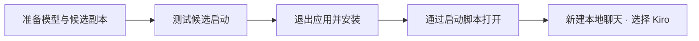
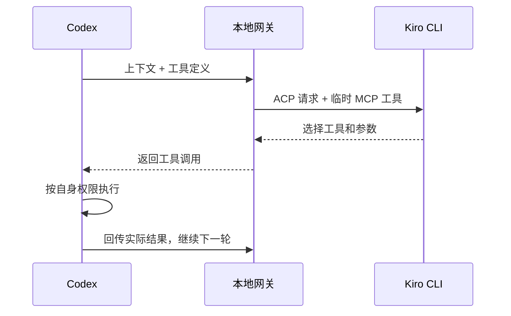

# Codex → Kiro

**在 Codex 中使用 Kiro CLI 账号的模型，继续沿用 Codex 的编辑与工具工作流。**

CLI 使用独立配置；macOS 桌面实验支持 OpenAI / Kiro 模型共存。


[快速开始](#快速开始cli) · [桌面接入](#桌面接入macos) · [模型选择](#模型选择) · [使用边界](#使用边界) · [技术文档](docs/TECHNICAL.md)

## 能做什么

| 使用场景 | 结果 |
| :--- | :--- |
| 用 Codex 做公司项目 | 模型请求交给已登录的 Kiro CLI |
| 保留个人原生模型 | 桌面新聊天可选择 OpenAI 或 Kiro |
| 读代码、执行命令、修改文件 | Kiro 选择工具，Codex 在自身权限下执行 |
| 选择 Kiro 模型 | 动态获取当前 CLI 的模型列表 |

**实测状态（2026-10-13）：** CLI 与桌面 Kiro 基本文本调用已跑通，`auto` 工具闭环通过；`gpt-5.6-sol` 用户图片与工具图片结果已实测。曾发现 21 个 Kiro 选项，数量随账号及服务变化；未逐个验证推理。

## 快速开始：CLI

准备 **Node.js 20+、Codex CLI、已登录的 Kiro CLI**。首次安装需执行 `npm ci`（JSON Schema 校验使用 Ajv）。

```sh
git clone git@github.com:pengguogo/codex-kiro.git
cd codex-kiro
npm ci

kiro-cli login
npm run doctor
npm run codex
```

在自己的项目目录启动：

```sh
cd /你的项目目录
node /绝对路径/codex-kiro/src/cli.mjs run
```

启动器自动管理本地网关与密码，使用独立的 `~/.config/codex-kiro/codex` 配置目录。

## 桌面接入：macOS

> 桌面方案为实验性补丁，目前仅实测 **26.1007.30912 / Apple Silicon / macOS 14.5**。它修改应用资源并重新签名；应用升级后可能需要重新准备，通知、钥匙串共享等能力尚未验证。



其他 Mac 已安装并登录 Kiro CLI 和桌面应用、候选应用也能正常登录时：先用 **⌘Q 退出原应用和候选应用**，然后执行：

```sh
git clone https://github.com/pengguogo/codex-kiro.git
cd codex-kiro
./scripts/install-desktop.command
```

需要 **Node.js 20+、Python 3.11+、npm**。缺少依赖时脚本会提示安装命令；首次准备补丁还需联网下载格式化工具。Finder 双击 `.command` 也可运行。

| 入口 | 用途 |
| :--- | :--- |
| `scripts/install-desktop.command` | 安装依赖、发现模型、准备并校验签名、首次安装或升级、启动 |
| `scripts/launch-desktop.command` | 日常启动；验证并停止本项目旧网关，再启动新网关和桌面应用 |
| `scripts/rollback-desktop.command` | 恢复原应用、撤回 Kiro 配置，再打开应用 |

启动会中断旧网关上的请求；**桌面应用仍在运行时只提示退出，不自动关闭**。端口被其他程序占用、认证不匹配或旧网关无法正常退出时停止操作，不强杀其他进程。请保留仓库目录，配置中的认证命令会引用它。

新建**本地聊天** → 选择 **Kiro · Auto** → 发送测试消息。跨 OpenAI / Kiro 切换请新建聊天。脚本自动绕过本地地址的代理。

重复执行安装脚本会升级补丁，并保留首次安装的回滚基线。备份位于 `~/.config/codex-kiro/coexist/backups/`，升级快照位于 `upgrades/`；回滚保留其他偏好修改。不要复制其他电脑的配置、登录凭据或备份。

完整准备、兼容性及排错步骤见 [桌面接入指南](docs/DESKTOP.md)。

## 模型选择

```sh
# 查看当前 Kiro CLI 返回的模型
npm run models

# CLI 指定模型；用列表中的实际 ID 替换
KIRO_MODEL='<模型 ID>' npm run codex

# 刷新桌面混合模型列表，然后重启应用
node src/coexist.mjs --refresh
```

`auto` 使用 CLI 默认模型。网关公开 ID 带 `kiro/` 前缀；未知模型会报错，不静默换模型。

## 工具如何执行



每个模型步骤会新建 ACP 会话并重传上下文。网关不执行项目命令，Kiro 原生 shell / 文件工具被禁用。协议细节见 [技术文档](docs/TECHNICAL.md)。

## 使用边界

| 已支持 | 暂不支持 |
| :--- | :--- |
| 文本、SSE、嵌入图片输入及工具图片结果 | 音频、远程图片 URL / OpenAI file ID |
| function / namespace / custom / 客户端 tool_search | OpenAI 托管生图、内置网页搜索、云端任务 |
| `apply_patch`、插件工具发现与多轮工具回传 | Responses WebSocket、`previous_response_id` |
| 超时、断连取消、本地认证、JSON Schema 最终输出 | 原生约束解码 |

模型出现或切换成功不等于推理权限已验证。复杂长任务仍需验证。usage 未映射，界面显示 0 tokens **不代表 Kiro 免费**；额度请以 Kiro 为准。

### 为什么 Kiro 聊天可能没有生图工具？

网关能转交 Codex 客户端实际提供的工具，包括命名空间里的生图函数；`tool_search` 返回的新插件工具也能继续调用。图片结果会转成真正的 ACP 图片块，供支持图片的 Kiro 模型查看。模型目录开启图片输入和插件使用指引，但目录声明不能给账号或桌面应用增加权限。

OpenAI Responses 的 `image_generation` 是在 OpenAI 服务端执行的托管工具，Kiro CLI 不提供对应生图服务。该类型会明确报错，不会偷偷消耗个人 OpenAI 额度。若桌面应用没有向 Kiro 会话暴露客户端生图函数，需使用自带模型的聊天，或安装自己有权限使用的生图 MCP；网关无法凭空注册桌面内部工具。两种工具的区别与排查步骤见 [工具兼容说明](docs/TOOLS.md)。

## 文档与参考

- [配置与协议](docs/TECHNICAL.md)：环境变量、手动 provider 配置、工具机制及开源参考。
- [桌面接入](docs/DESKTOP.md)：安装、回滚、代理与签名兼容处理。
- [验证记录](VALIDATION.md)：实测范围与已知失败。
- [Kiro ACP 文档](https://kiro.dev/docs/cli/acp/) · [桌面补丁设计参考](https://github.com/Keksuccino/Better-Codex-App-Custom-Provider-Support)。

开发验证：`npm test`。
