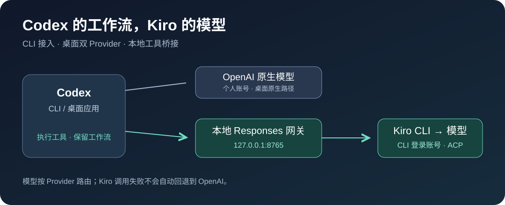
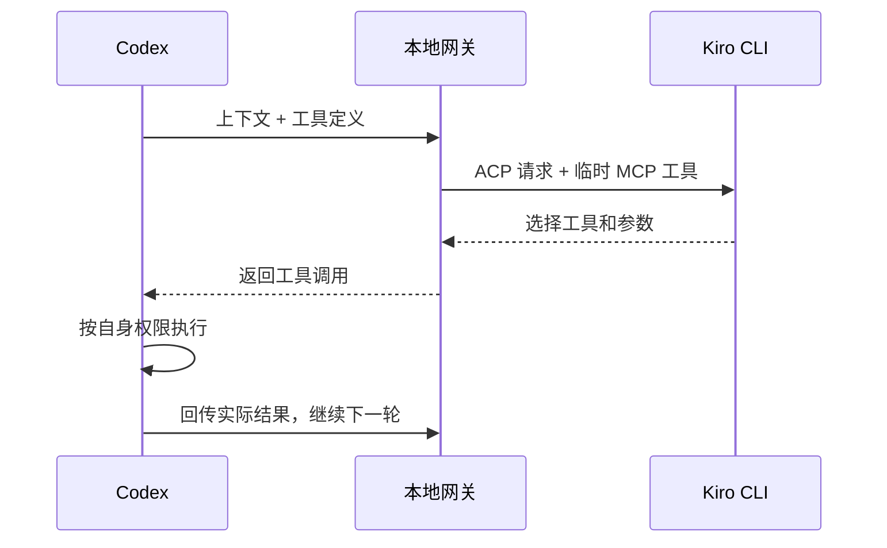

# Codex → Kiro

**在 Codex 中使用 Kiro CLI 账号的模型，继续沿用 Codex 的编辑与工具工作流。**

CLI 使用独立配置；macOS 桌面实验支持 OpenAI / Kiro 模型共存。



[快速开始](#快速开始cli) · [桌面接入](#桌面接入macos) · [模型选择](#模型选择) · [使用边界](#使用边界) · [技术文档](docs/TECHNICAL.md)

## 能做什么

| 使用场景 | 结果 |
| :--- | :--- |
| 用 Codex 做公司项目 | 模型请求交给已登录的 Kiro CLI |
| 保留个人原生模型 | 桌面新聊天可选择 OpenAI 或 Kiro |
| 读代码、执行命令、修改文件 | Kiro 选择工具，Codex 在自身权限下执行 |
| 选择 Kiro 模型 | 动态获取当前 CLI 的模型列表 |

**实测状态（2026-10-12）：** CLI 与桌面 Kiro 基本文本调用已跑通，`auto` 工具闭环通过，18 项自动化测试通过。曾发现 21 个 Kiro 选项，数量随账号及服务变化；未逐个验证推理。

## 快速开始：CLI

准备 **Node.js 22+、Codex CLI、已登录的 Kiro CLI**。无需安装 npm 依赖。

```sh
git clone git@github.com:pengguogo/codex-kiro.git
cd codex-kiro

kiro-cli login
npm run doctor
npm run codex
```

在自己的项目目录启动：

```sh
cd /你的项目目录
node /绝对路径/codex-kiro/src/cli.mjs run
```

启动器自动管理本地网关与密码，使用独立的 `~/.config/codex-kiro/codex` 配置目录。

## 桌面接入：macOS

> 桌面方案为实验性补丁，目前仅实测 **26.1007.30912 / Apple Silicon / macOS 14.5**。它修改应用资源并重新签名；应用升级后可能需要重新准备，通知、钥匙串共享等能力尚未验证。


**① 准备** · 在仓库根目录执行，额外需要 Python 3.11+：

```sh
node src/desktop.mjs prepare
node src/coexist.mjs
python3 scripts/prepare-desktop-patch.py
```

**② 试启动** · ⌘Q 退出原应用后打开候选；此时 Kiro 配置尚未安装：

```sh
open -n "$HOME/.config/codex-kiro/coexist/ChatGPT-Kiro-staged.app"
```

**③ 安装与使用** · 确认候选能启动，⌘Q 退出后执行：

```sh
python3 scripts/manage-desktop.py install
./scripts/launch-desktop.command
```

新建**本地聊天** → 打开模型选择器 → 选择 **Kiro · Auto** → 发送一条测试消息。

跨 OpenAI / Kiro 切换请新建聊天。日常使用启动脚本，它会让本地网关地址绕过代理，避免 `502 Bad Gateway`。

<details>
<summary>↩️ 需要回滚？</summary>

⌘Q 退出后执行：

```sh
python3 scripts/manage-desktop.py restore
open /Applications/ChatGPT.app
```

原应用和配置备份位于 `~/.config/codex-kiro/coexist/backups/`。回滚保留其他偏好修改；应用已升级时保留新版应用，仅撤回本次配置。

</details>

完整准备、兼容性及排错步骤见 [桌面接入指南](docs/DESKTOP.md)。

## 模型选择

```sh
# 查看当前 Kiro CLI 返回的模型
npm run models

# CLI 指定模型；用列表中的实际 ID 替换
KIRO_MODEL='<模型 ID>' npm run codex

# 刷新桌面混合模型列表，然后重启应用
node src/coexist.mjs --refresh
```

`auto` 使用 CLI 默认模型。网关公开 ID 带 `kiro/` 前缀；未知模型会报错，不静默换模型。

## 工具如何执行



每个模型步骤会新建 ACP 会话并重传上下文。网关不执行项目命令，Kiro 原生 shell / 文件工具被禁用。协议细节见 [技术文档](docs/TECHNICAL.md)。

## 使用边界

| 已支持 | 暂不支持 |
| :--- | :--- |
| 文本与 SSE 流式输出 | 图片、音频 |
| function / namespace / custom 工具 | 内置网页搜索、云端任务 |
| `apply_patch` 与多轮工具回传 | Responses WebSocket、`previous_response_id` |
| 超时、断连取消、本地认证 | 结构化最终输出 |

模型出现或切换成功不等于推理权限已验证。复杂长任务仍需验证。usage 未映射，界面显示 0 tokens **不代表 Kiro 免费**；额度请以 Kiro 为准。

## 文档与参考

- [配置与协议](docs/TECHNICAL.md)：环境变量、手动 provider 配置、工具机制及开源参考。
- [桌面接入](docs/DESKTOP.md)：安装、回滚、代理与签名兼容处理。
- [验证记录](VALIDATION.md)：实测范围与已知失败。
- [Kiro ACP 文档](https://kiro.dev/docs/cli/acp/) · [桌面补丁设计参考](https://github.com/Keksuccino/Better-Codex-App-Custom-Provider-Support)。

开发验证：`npm test`。
